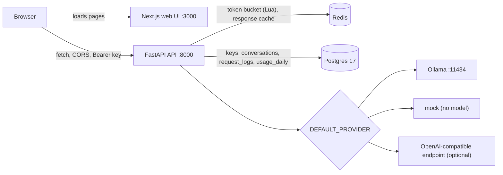

# Tollgate

Tollgate is a small, self-hosted gateway with an OpenAI-style `/v1/chat` endpoint. It sits in front of a local model (Ollama by default, or a mock provider, or an optional OpenAI-compatible endpoint) and adds per-key rate limits, an exact-match response cache, and usage tracking in Postgres. It uses no paid services. A Next.js web UI gives a chat playground, a usage dashboard, and key management.

It is a portfolio project. It is not a production multi-tenant service. The limits section lists what it does not do.

## Architecture



Request path for `POST /v1/chat`:

1. Authenticate the Bearer key. Revoked and unknown keys get 401.
2. Take one token from the key's bucket. An empty bucket returns 429 with `Retry-After`. If Redis is down, the request fails closed with 503.
3. If `conversation_id` is given, check that the conversation belongs to this key.
4. For cacheable requests, look up the cache. A hit returns `X-Cache: HIT`.
5. Otherwise call the provider. Non-stream replies are stored in the cache when the request was cacheable (`X-Cache: MISS`). Other requests get `X-Cache: BYPASS`.
6. Write the request log, usage rollup, and conversation turns to Postgres.

## Quickstart

Docker is the intended path, but it was not available on the machine where this project was developed. The Compose file and the two Dockerfiles have not been run. The local path below is the one that was verified.

### Option A: Docker Compose (not tested in this repo yet)

```bash
cp .env.example .env
# Edit .env. Set ADMIN_API_KEY to a non-default value. APP_ENV defaults to production in
# Compose, and the API refuses to start in production with the default admin key.
docker compose up --build                     # API, Postgres, Redis
docker compose --profile ollama up --build    # also runs Ollama
docker compose exec ollama ollama pull llama3.2:3b
docker compose --profile web up --build       # also runs the web UI on http://localhost:3000
```

With no Ollama, set `DEFAULT_PROVIDER=mock` in `.env` before `docker compose up`.

### Option B: local, no Docker

Verified on the development machine with system Postgres 17 and Redis 8 on 127.0.0.1.

1. Copy the environment file and set a real admin key:
   ```bash
   cp .env.example .env
   ```
   Edit `ADMIN_API_KEY`. For a model-free start, set `DEFAULT_PROVIDER=mock`. For Ollama, install it, run `ollama pull llama3.2:3b`, and keep `DEFAULT_PROVIDER=ollama`.
2. Create the databases and role (default URLs in `.env.example`):
   ```sql
   CREATE ROLE tollgate LOGIN PASSWORD 'tollgate' CREATEDB;
   CREATE DATABASE tollgate OWNER tollgate;
   CREATE DATABASE tollgate_test OWNER tollgate;
   ```
3. Start Postgres and Redis on 127.0.0.1:5432 and 127.0.0.1:6379.
4. Install the Python side and run migrations:
   ```bash
   make setup        # creates .venv and installs the package with dev extras
   make migrate
   make seed         # optional: writes a demo key to .demo-key (gitignored)
   ```
5. Install the web dependencies and run both servers:
   ```bash
   npm --prefix web install
   make dev          # API on http://localhost:8000
   make dev-web      # UI on http://localhost:3000
   ```
6. Open http://localhost:3000, save an API key in the top bar, and send a message. Create keys on the Keys page with the admin key.

## API examples

Set the admin key from `.env`, then create a key. The response contains `key`, which is shown only once.

```bash
export ADMIN=change-me-admin   # your ADMIN_API_KEY
curl -s -X POST http://localhost:8000/v1/admin/keys \
  -H "X-Admin-Key: $ADMIN" -H "Content-Type: application/json" \
  -d '{"name":"laptop","rate_limit_rpm":60,"cache_enabled":true}'
export KEY=tg_...   # the "key" value from the response
```

A cacheable request (`temperature` 0, not streamed) returns `X-Cache: MISS` the first time and `X-Cache: HIT` when repeated unchanged:

```bash
BODY='{"messages":[{"role":"user","content":"Say hi"}],"temperature":0,"stream":false}'
curl -s -i -X POST http://localhost:8000/v1/chat \
  -H "Authorization: Bearer $KEY" -H "Content-Type: application/json" -d "$BODY" \
  | grep -iE "^HTTP|^x-cache|conversation_id"
# first call:  x-cache: MISS
# second call: x-cache: HIT
```

Rate limit: create a key with `"rate_limit_rpm":1`, then send two requests quickly. The second returns 429:

```bash
export KEY1=tg_...   # key created with rate_limit_rpm 1
curl -s -i -X POST http://localhost:8000/v1/chat \
  -H "Authorization: Bearer $KEY1" -H "Content-Type: application/json" -d "$BODY" \
  | grep -iE "^HTTP|retry-after|detail"
# HTTP/1.1 429 Too Many Requests
# retry-after: <seconds>
# {"detail":"Rate limit exceeded"}
```

Streaming: `stream: true` returns `text/event-stream`. Each `data:` line is a `chat.completion.chunk`, and the stream ends with `data: [DONE]`.

```bash
curl -N -X POST http://localhost:8000/v1/chat \
  -H "Authorization: Bearer $KEY" -H "Content-Type: application/json" \
  -d '{"messages":[{"role":"user","content":"Stream a reply"}],"stream":true}'
```

Other endpoints: `GET /healthz`, `GET /v1/usage/summary?from=&to=`, `GET /v1/usage/recent?limit=50`, `GET /v1/keys`, `POST /v1/admin/keys`, `POST /v1/keys/{id}/revoke`. Usage and key listing accept either a user key (own data only) or the admin key (all keys).

## Design decisions

**Token bucket in Lua.** Each key has a bucket with capacity equal to its `rate_limit_rpm` and refill of rpm per 60 seconds. The refill and the token consumption run in one Lua script on Redis. Two concurrent requests cannot both read the same token count and both spend the last token. The script takes its clock from Redis `TIME`, so app-server clock skew does not matter.

**Cache key.** The cache key is `sha256` of the canonical JSON (sorted keys) of `model`, `messages` (role and content, in order), `temperature`, `top_p`, and `max_tokens`. A missing `temperature` counts as 0, so it is cacheable.

**What is not cached.** These requests get `X-Cache: BYPASS` and are never looked up or stored:

- streamed requests (`stream: true`);
- requests with `temperature` other than 0;
- requests from a key with `cache_enabled: false`.

**Cache hits still persist.** A hit writes the conversation turns and a request log. `request_logs` and `usage_daily` record 0 tokens for a hit, because no tokens were generated. The JSON body still returns the cached `usage` counts, which describe the original generation.

**Cache is shared across keys.** The cache key does not include the API key id. If key A asks a question and key B later asks the same question with the same parameters, key B receives key A's cached reply. Set `cache_enabled: false` on keys that must not share replies. This is a real limitation, not a multi-tenant design.

**Cache ignores the provider.** The cache key does not include the provider name. After you change `DEFAULT_PROVIDER`, cached replies from the old provider can still be served until the TTL (`CACHE_TTL_SECONDS`, default 3600) expires.

**Usage numbers.** `cache_hit_rate` is hits divided by requests. `p95_latency_ms` is computed from `request_logs.latency_ms` and is `null` when the window has no requests. Streamed requests record token counts from the provider when it reports them. Otherwise the server estimates them.

## Web UI

- **Playground (`/`)**: transcript with live token streaming, Enter to send and Shift+Enter for a newline, model, temperature, max tokens, and stream settings, and a New chat button. Each reply shows its `X-Cache` value and token counts for non-streamed replies. A 429 shows `Retry-After`.
- **Usage (`/usage`)**: summary cards and the latest 50 requests. The date range applies to the summary only, because the recent-requests endpoint takes only a limit.
- **Keys (`/keys`)**: admin key entry, key creation (the plaintext is shown once with a copy button), a key table, and revoke.

The browser stores the API key and the admin key in `localStorage` under `tollgate.apiKey` and `tollgate.adminKey`. Any script running on the page can read them. Use this only on a machine you control.

## Limits

- No multi-tenant isolation. Keys are not scoped to users or teams, and the cache is shared (see above).
- No SSO, no billing, no per-user quotas beyond the key rate limit.
- Prompt-injection defenses are basic. The gateway forwards messages as sent.
- Conversation transcripts in the web UI live only in the browser tab. The server stores turns, but the UI has no endpoint to reload them.
- Docker Compose and both Dockerfiles have not been built or run in this repository yet.
- CI is not wired yet. There are no automated checks on push.
- The Compose file pins Redis 7 and Postgres 17. Local verification used Redis 8.

## Tests and checks

```bash
make test   # pytest against Postgres (tollgate_test) and Redis db 1, using the mock provider
make lint   # ruff check and format check, and mypy on src
```

`make test` needs the local database and role from Quickstart step 2. Tests set `DEFAULT_PROVIDER=mock`, so no model is required.

For the web UI:

```bash
npm --prefix web run lint
cd web && npx tsc --noEmit
npm --prefix web run build
```

## Roadmap

- Wire CI once the GitHub Actions setup is available.
- Scope cache entries by key (or by key owner) so keys cannot share replies.
- Store conversation history for the web UI to reload.
- Add a Compose smoke test once Docker is available for verification.

## Author

Ram Surya Chelluboyina (GitHub: [RamSuryaCH](https://github.com/RamSuryaCH)). License: MIT, see `LICENSE`.
