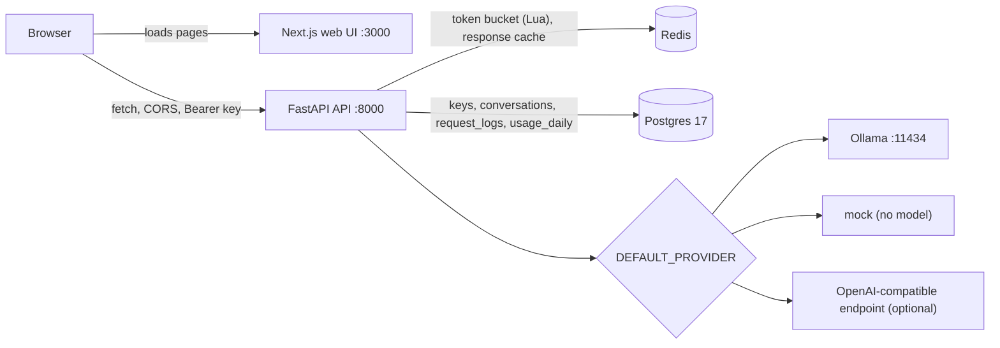
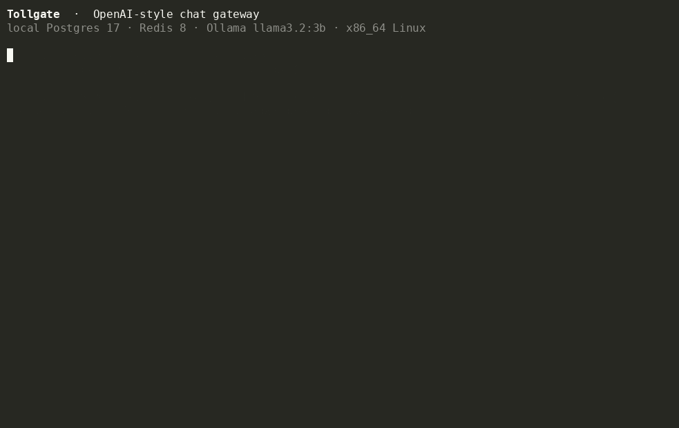
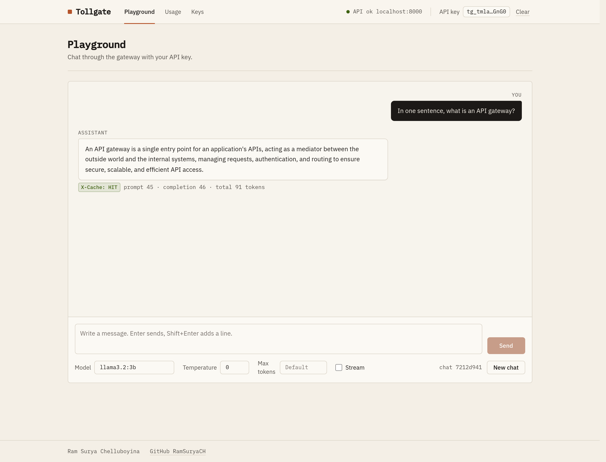
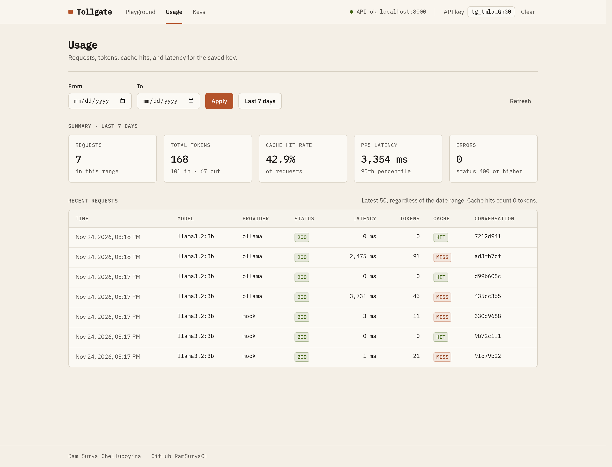
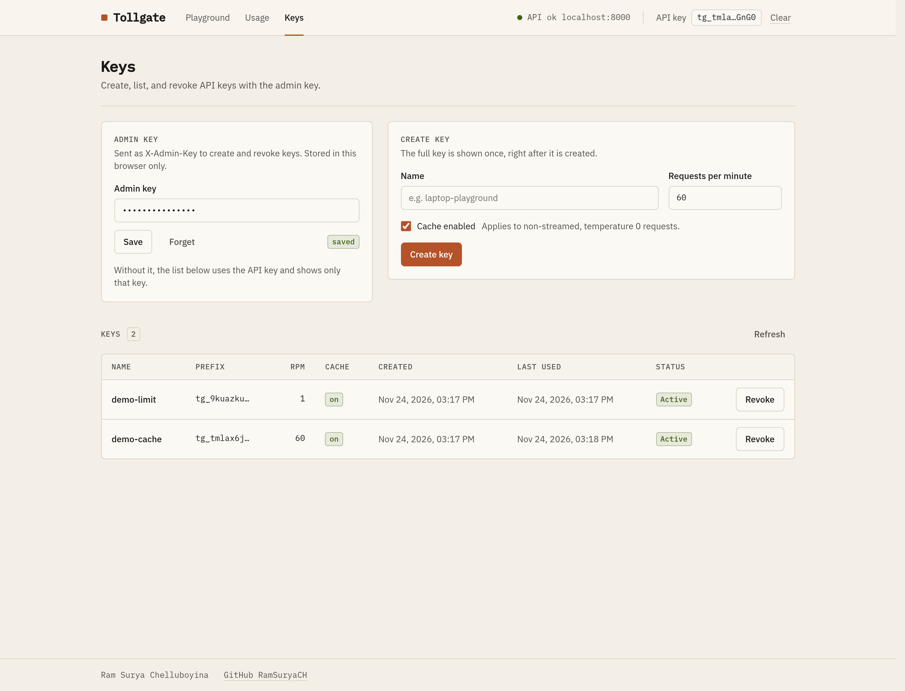

# Tollgate

Self-hosted OpenAI-style chat gateway with per-key rate limits, exact-match response caching, and usage tracking — no paid services required.

[](LICENSE)
[](https://www.python.org/)
[](https://nextjs.org/)

## Architecture



`POST /v1/chat` authenticates a hashed API key, takes one token from that key's Redis token bucket, serves an exact-match cache hit when the request is cacheable, otherwise calls the provider, then writes the request log, usage rollup, and conversation turns to Postgres.

## Demo

Cache **MISS**, then **HIT** on the same request, then **429** when a key's bucket is empty. Recorded against the local stack: Postgres 17, Redis 8, and Ollama `llama3.2:3b`.



The web UI is a small Next.js app: a streaming playground, a usage dashboard, and API key management.







Screenshots are from the local stack (Next.js production build + FastAPI + Ollama) on 24 Nov 2026.

## Quickstart

**Requirements:** Python 3.12+, Node 20+, Postgres 17, and Redis on `127.0.0.1`. For a local model, [Ollama](https://ollama.com) with `llama3.2:3b`. For a model-free run, set `DEFAULT_PROVIDER=mock`.

```bash
cp .env.example .env          # set ADMIN_API_KEY; optionally DEFAULT_PROVIDER=mock
make setup                    # .venv and Python deps
make migrate && make seed     # seed prints a demo key and writes .demo-key (gitignored)
make dev                      # API at http://localhost:8000
npm --prefix web install && make dev-web   # UI at http://localhost:3000
```

Open http://localhost:3000, paste the demo key, and send a message. Create more keys on the Keys page with the admin key.

**Docker** is the intended production-style path (`docker compose up --build`, plus `--profile ollama` and `--profile web`), but Docker was not available on the development machine, so Compose and the Dockerfiles have not been run. Set a non-default `ADMIN_API_KEY` before Compose: the API refuses to start in production with the default admin key.

## Latency (measured)

Measured on **24 Nov 2026** on the development machine: **x86_64 Linux** (Debian 13, Intel Xeon, 8 cores, 16 GB RAM), **not an Apple Silicon Mac**.

Method: `POST /v1/chat` from the same host with Python `httpx`, wall-clock from request send to full JSON body received. `temperature=0`, `stream=false`, `max_tokens=16`, model `llama3.2:3b`. Uvicorn + Postgres 17 + Redis 8 on `127.0.0.1`, no Docker, no proxy. MISS uses a unique prompt each time. HIT repeats one already-cached prompt. Percentiles use linear interpolation over the sorted sample; warmup requests are discarded. The Ollama model was already loaded (`llama3.2:3b`, Q4_K_M).

| Provider | Cache | N | Warmup discarded | p50 (ms) | p95 (ms) |
| --- | --- | ---: | ---: | ---: | ---: |
| mock (in-process) | MISS | 100 | 5 | 8.05 | 10.14 |
| mock (in-process) | HIT | 100 | 5 | 7.63 | 8.96 |
| llama3.2:3b (Ollama) | MISS | 20 | 3 | 188.65 | 213.07 |
| llama3.2:3b (Ollama) | HIT | 20 | 3 | 7.72 | 11.67 |

A cache hit still writes a request log and conversation turns to Postgres, so mock HIT and MISS are close: the mock provider is already in-process. The cache matters when the model call is the expensive part. These numbers are for a short completion (`max_tokens=16`); a longer MISS would be slower.

## API examples

```bash
export ADMIN=…   # ADMIN_API_KEY
curl -s -X POST http://localhost:8000/v1/admin/keys \
  -H "X-Admin-Key: $ADMIN" -H "Content-Type: application/json" \
  -d '{"name":"laptop","rate_limit_rpm":60,"cache_enabled":true}'
export KEY=tg_…  # the "key" field; shown only once
```

A cacheable request (`temperature` 0, not streamed) returns `X-Cache: MISS` the first time and `X-Cache: HIT` when repeated unchanged:

```bash
BODY='{"messages":[{"role":"user","content":"Say hi"}],"temperature":0,"stream":false}'
curl -sS -D- -o /tmp/tg-body.json -X POST http://localhost:8000/v1/chat \
  -H "Authorization: Bearer $KEY" -H "Content-Type: application/json" -d "$BODY"
```

A key with `"rate_limit_rpm": 1` returns `429` and `Retry-After` on the second immediate request. `stream: true` returns `text/event-stream` chunks and ends with `data: [DONE]` (`X-Cache: BYPASS`).

Other endpoints: `GET /healthz`, `GET /v1/usage/summary`, `GET /v1/usage/recent`, `GET /v1/keys`, `POST /v1/keys/{id}/revoke`.

## Design decisions

**Token bucket in Lua.** Each key has a bucket with capacity equal to its `rate_limit_rpm` and a refill of rpm per 60 seconds. Refill and consume run in one Lua script on Redis, so two concurrent requests cannot both spend the last token. The script uses Redis `TIME`. If Redis is down, chat fails closed with 503.

**Cache key.** `sha256` of the canonical JSON (sorted keys) of `provider`, `model`, `messages` (role and content, in order), `temperature`, `top_p`, and `max_tokens`. A missing `temperature` counts as 0 and is cacheable. The provider name is included so a cached mock (or Ollama) reply is not served after you switch `DEFAULT_PROVIDER`.

**What is not cached.** These get `X-Cache: BYPASS` and are never looked up or stored: streamed requests, `temperature` other than 0, and keys with `cache_enabled: false`.

**Cache hits still persist.** A hit writes the conversation turns and a request log. `request_logs` and `usage_daily` record 0 tokens for a hit (no new generation). The JSON body still returns the cached `usage` counts.

**Cache is shared across keys.** The cache key does not include the API key id. If key A and key B send the same cacheable request, key B can receive key A's cached reply. Set `cache_enabled: false` on keys that must not share replies.

## Honest limits

- Docker Compose and both Dockerfiles have not been built or run in this repository. They are shipped for other machines; local verification used system Postgres and Redis.
- No arm64 Mac run. Development and the latency table above are from an x86_64 Linux box. Images are official multi-arch tags with no `platform: linux/amd64` pin, but that was not executed here.
- The optional OpenAI-compatible provider is implemented and wired but was not live-tested (no upstream URL or key).
- The cache is shared across API keys, as noted above. There is no multi-tenant isolation, SSO, or billing.
- Conversation transcripts in the web UI live in the tab. The server stores turns, but the UI has no endpoint to reload them.
- CI is not wired. There is no GitHub Actions workflow.

## Tests

```bash
make test   # pytest against Postgres (tollgate_test) and Redis db 1, mock provider
make lint   # ruff check, ruff format --check, and mypy on src
cd web && npx tsc --noEmit && npm run lint && npm run build
```

`make test` needs the `tollgate` / `tollgate_test` databases from `.env.example`. Tests set `DEFAULT_PROVIDER=mock`, so no model is required.

## Author

Ram Surya Chelluboyina (GitHub: [RamSuryaCH](https://github.com/RamSuryaCH)). License: MIT, see `LICENSE`.
